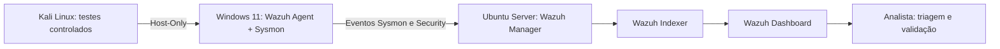

# Arquitetura e topologia — SOC Home Lab

## Visão geral

O laboratório utiliza três máquinas virtuais no Oracle VirtualBox, com responsabilidades separadas para geração de atividade controlada, monitoramento de endpoint e análise centralizada.

## Componentes

| Máquina | Papel | Versão observada |
|---|---|---|
| Servidor SIEM | Manager, Indexer e Dashboard | Ubuntu Server 24.04.5 LTS; Wazuh 4.14.10 |
| Endpoint Windows | Endpoint monitorado | Windows 11 Pro; Wazuh Agent 4.14.10; Sysmon 15.22 |
| Estação de testes Linux | Origem de atividades controladas | Kali Linux 2026.3; Nmap 7.99 |
| Host | Virtualização | Oracle VirtualBox 7.2.22 |

## Rede

Os testes entre convidados utilizaram uma rede virtual Host-Only, separada da rede física. Interfaces NAT permaneceram disponíveis para operações controladas, como atualização dos sistemas. Os endereços internos exatos foram omitidos desta versão pública.

A presença de NAT não transforma o alvo em um sistema externo: os procedimentos descritos foram direcionados às VMs próprias e à rede virtual do laboratório.

## Fluxo de telemetria

1. Kali ou o próprio Windows gera uma atividade benigna e controlada.
2. Windows registra eventos nos canais Sysmon ou Security.
3. Wazuh Agent coleta os canais configurados e encaminha eventos ao Manager.
4. Wazuh Manager decodifica os eventos e avalia regras nativas e locais.
5. Os alertas são indexados e apresentados no Dashboard.
6. A análise verifica sequência, origem, processo, evento, regra, severidade e mapeamento MITRE ATT&CK.

## Controles e limites

- Manter atividades de teste restritas à rede Host-Only e a ativos próprios ou autorizados.
- Não executar varreduras ou tentativas de autenticação em redes externas.
- Evitar credenciais reais nas VMs de laboratório.
- Tratar nomes de host, IPs internos, GUIDs, hashes e identificadores de agente como dados a revisar antes de publicar.
- Não interpretar ausência de resposta de rede ou estado filtered como prova de que um serviço está aberto ou fechado.
